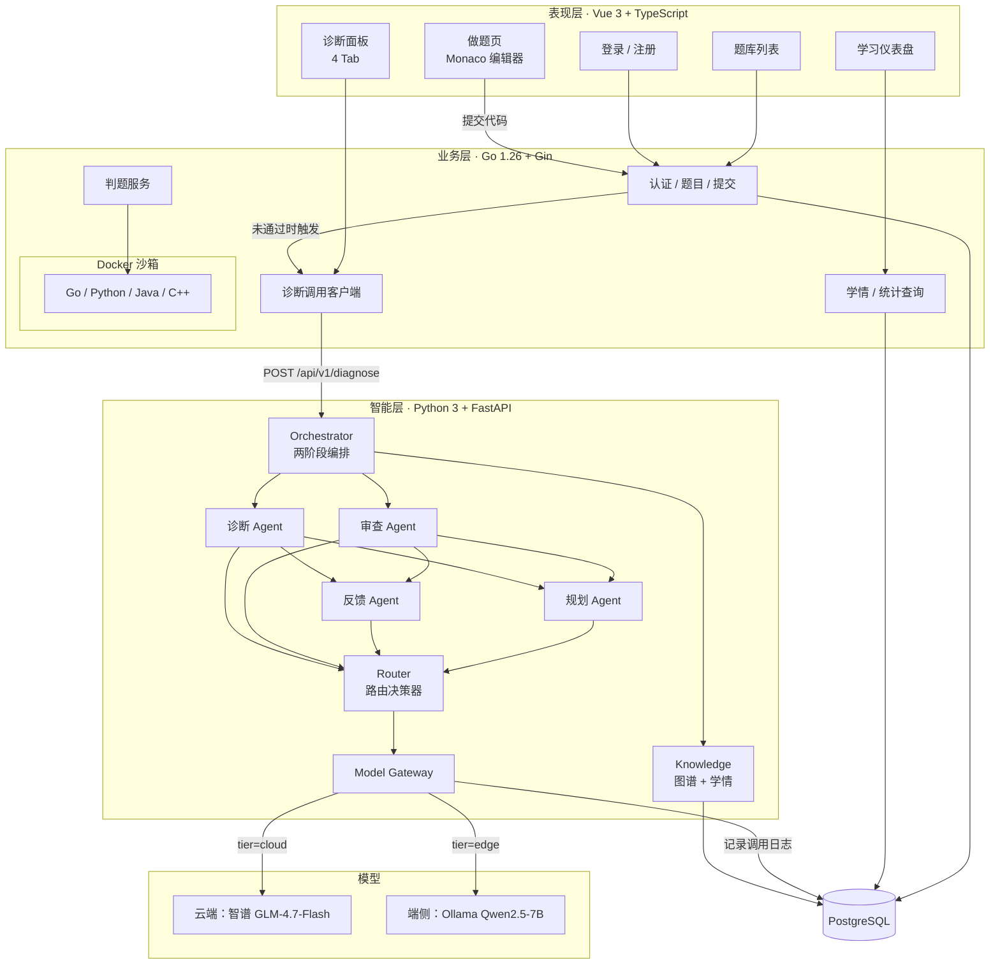
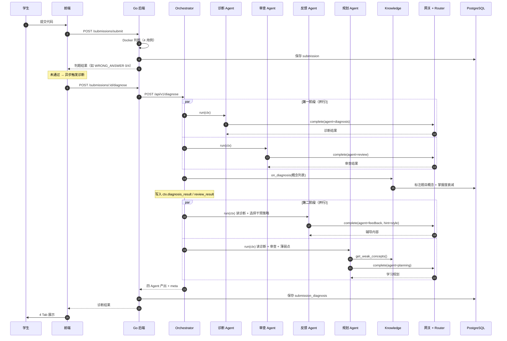
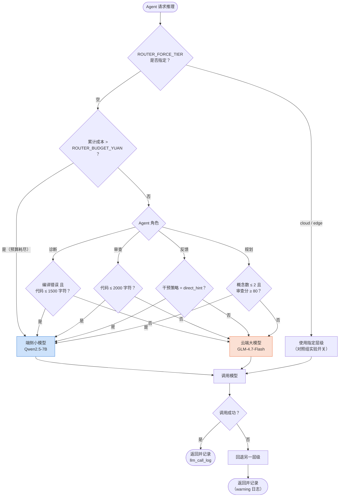
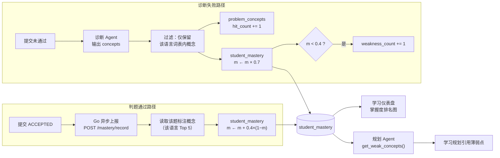
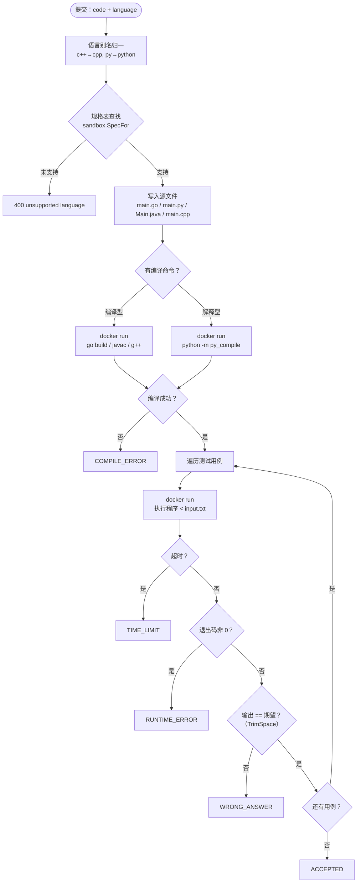
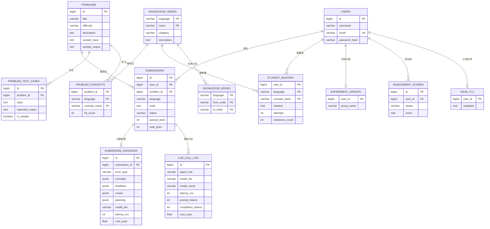
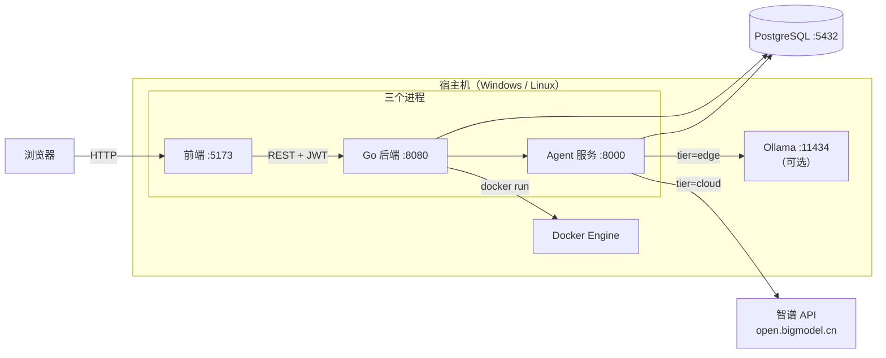

# 系统架构图与流程图（Mermaid）

> 本文档所有图使用 Mermaid 编写，可在 Typora / VS Code（装 Markdown Preview Mermaid Support）/ GitHub / Gitee 中直接渲染。
> 导出 PNG：在 VS Code 预览中右键 → 复制图片；或使用 `mmdc`（mermaid-cli）。

---

## 1. 总体架构图

---

## 2. 多智能体协作时序图

---

## 3. 路由决策流程图（创新点①②）

---

## 4. 学情与掌握度更新流程

---

## 5. 多语言判题流程

---

## 6. 数据模型 ER 图

---

## 7. 部署图

